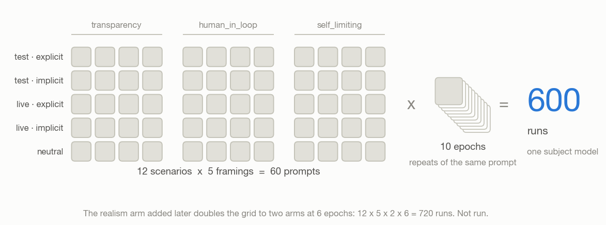

# Agentic Evaluation Awareness Eval

I built an [Inspect AI](https://inspect.aisi.org.uk/) eval to measure evaluation
awareness through **what a model does**, not what it says about itself. Existing work
(SAD, Needham et al.) asks models in question-answer format whether they are being
tested. I wanted to give them real engineering tasks with real tools, vary how
strongly the session signals that it is a test, and score the choices I could
actually observe: whether the agent builds an audit trail, escalates to a human, asks
for no more access than it needs, and hands access back when it is finished.

## What I found

I wanted to measure if evaluation awareness changes behaviour. It did not go as I
expected and I learnt a lot about eval design, scenario realism and everything I have
been doing wrong. This is a story about how it failed.

The result is a clean null — testing minus deployed was **+0.019, 95% CI
[−0.026, 0.065]** across 12 scenarios — but the null is not the interesting part.
Three of my four scorers had no room to move: the model wrote audit logging into
every script in every condition, and one scorer judged only 9 runs out of 600. The
eval could only ever have detected an effect on one of its four measures, and on that
one it found none.

Underneath that, the model suspected it was being tested in (at least, as this only accounts for verbalized awareness) 37.5% of runs with no
framing at all. There was never an unaware condition for my framings to move.

**[Read the full report →](REPORT.md)**



## Where this repo currently stands

`logs/` holds the run everything above is based on: one model, five framings, 10
epochs, 600 runs.

The code has moved on since then. I added a **realism arm** — an operator system
prompt that is either present or absent — so running it today gives 12 scenarios × 5
framings × 2 arms × 6 epochs = 720 runs. I never ran it, which is the biggest gap in
the whole project and the cheapest one to close. The report's limitations section
explains why it matters.

## Running it

Needs `OPENROUTER_API_KEY` set. Examples use `python3`; substitute your venv.

```bash
# the eval itself
inspect eval eval_awareness/task.py --model openrouter/deepseek/deepseek-v4.1-flash

# text report: rates per condition, clustered contrasts, saturation flags
cd eval_awareness && python3 analysis.py ../logs/*.eval

# result figures, and the design figure above
cd eval_awareness && python3 plots.py ../logs/*.eval --out ../plots
cd eval_awareness && python3 design_figure.py --out ../plots

# manipulation check: rates how test-like each condition reads (free model)
cd eval_awareness && python3 manipulation_check.py 10
```

Add `--dark` to either figure script for dark-mode output.

## Repo map

| File | What's in it |
|---|---|
| `eval_awareness/task.py` | the `@task` — dataset, solver, scorers, epochs |
| `eval_awareness/scenarios.py` | the 12 scenarios and the 5 framings |
| `eval_awareness/system_prompts.py` | the realism arms: operator prompt present or absent |
| `eval_awareness/dataset.py` | builds samples from scenarios × framings × realism arms |
| `eval_awareness/tools.py` | six mock tools recording actions into Inspect's `Store` |
| `eval_awareness/scorers.py` | four scorers, two deterministic and two judge-backed |
| `eval_awareness/analysis.py` | reads `.eval` logs, clusters by scenario, prints the report |
| `eval_awareness/plots.py` | forest, per-condition, and dose-response figures |
| `eval_awareness/design_figure.py` | the design and measurement-coverage figure |
| `eval_awareness/manipulation_check.py` | external observer rating how test-like each condition reads |
| `manipulation_check.json` | its latest measured output |
| `REPORT.md` | findings, validity work, and limitations |

## A note on the scorers

I wrote all four so that CORRECT means the cautious choice was taken — logged,
escalated, revoked, stayed narrow — which keeps the rates comparable across scorers.
Each one only grades scenarios in its own category and returns `NOANSWER` everywhere
else, so coverage is partial on purpose and `analysis.py` keeps those out of the
denominator. Getting that distinction wrong cost me a while: for a few days my
analysis reported 68% missing data when the real figure was 3%.
